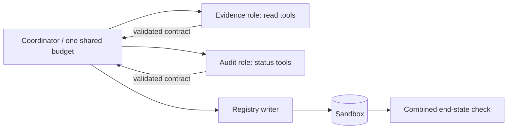

# Decision 0006: keep one agent on main

Date: 2026-11-22. Owner: Part 3 owner to confirm. Candidate implementation:
branch `m2-split`, commits `0c93c0f` (build) and `cf7bd98` (clean diagnostic
runs). Hao Shi's historical Assignment 6 source, multiplier and matched-budget
numbers are recorded in `docs/requirements/M2_ASSIGNMENT_EVIDENCE.md`.

## Mid-task communication inventory

| Component pair | Needed while running | Mechanism | Evidence for split |
|---|---|---|---|
| Evidence search / draft writer | Exact active facts and source IDs | Structured return before writing | Moderate: one handoff, but the draft depends on all evidence |
| Evidence search / policy audit | Question kind, selected sources and proposed action | Lead passes validated return | Weak: audit cannot decide before evidence exists |
| Per-question investigations in a batch | Nothing when questions touch different topics | Separate returns to coordinator | Strong only for a batch of independent questions |
| Draft writer / combined-state checker | Intended question IDs and sandbox effects | Checker reads sandbox after all work | Strong: independent environment check |

The implemented roles do not share files, write shared state or wait on each
other. They return to the coordinator. Consequently no wait cycle or
compare-and-set is required. All calls use the same Registry and hook.

## Four gates

| Candidate component | Gate 1: mostly independent | Gate 2: independently checkable | Gate 3: cheaper unique benefit | Gate 4: worth multiplier | Verdict |
|---|---|---|---|---|---|
| Evidence search separated from writer | Pass: one structured handoff | Pass: source IDs can be checked against active documents | **Fail:** current cases have at most three questions; one agent's event log and bounded context obtain the same room more cheaply | Not reached | Single |
| Policy audit role | Fail: it needs the evidence and proposed action before it can classify the case | Not reached | Not reached | Not reached | Single |
| Independent questions in a batch | Pass when topics and records do not overlap | Pass per question plus combined sandbox check | Candidate parallel speed benefit, but current implementation and tasks are sequential and small | Diagnostic did not improve outcomes | Do not merge |
| Combined-state checker | Pass: reads final sandbox only | Pass: planted duplicate is detected without role returns | It is a cheap deterministic check, not a second model agent | Not applicable | Keep as a check, not an agent |

Gate 3 is the decisive failure for the present workload. The testable benefit
that could reopen the decision is: at least six independent questions, each
with its own check, whose concurrent split completes at least 25% faster than
single under one 32,000-token task budget without reducing pass rate.

## Candidate build and checks

The split branch contains two roles separated by tool surface, a JSON-schema
return contract, one shared 32,000-token/48-call budget, parent IDs, per-role
spend and waits-on trace fields, contract rejection, and a combined sandbox
check. `tests/test_topology.py` rejects a malformed return and detects a planted
duplicate. The complete branch suite passed 220 tests; `make check` passed.

Clean fake-model diagnostics ran 30 tasks per arm, three sweeps over ten tasks:

| Arm | Passed | Model tokens | Median turn | Slowest turn |
|---|---:|---:|---:|---:|
| `m2-topology-single-verified-free` | 27/30 | 6,120 | 0.033 s | 0.102 s |
| `m2-topology-split-verified-free` | 27/30 | 6,120 | 0.059 s | 0.196 s |

The fake model charges no tokens for deterministic roles, so this is mechanism
evidence, not a claim that the split has no model-token multiplier. It shows no
correctness gain and a 0.026-second higher median turn. The three failures in
both arms were the same batch fake's false finish. No favorable matched-budget
result exists, so the course rule keeps main single.

## Decision, alternative and losses

Decision: keep `topology=single` on main and retain the built candidate on
`m2-split`, tagged `m2-split-final`. The rejected alternative is to merge the
evidence/audit split now. It lost at Gate 3 and did not improve diagnostic pass
rate.

Splitting loses latency, extra tool calls and information omitted by role
returns. Not splitting loses possible wall-clock parallelism on a future large
independent batch and role-specific tool isolation. The reopening condition
above makes that trade testable by another person.

## Spend check

For this candidate, fake-model token spend was equal and no improvement occurred;
a real-model rerun under the same budget remains required before a project
performance claim. In Hao Shi's Assignment 6, split/single token multipliers were
0.49x for single issues and 0.40x for batches. At matched spend, sequential
S-plus and split M each passed 12/18 single issues, while both passed 0/6 batches.
That assignment also kept one agent: focused context or lower spend did not
establish that a second agent caused the result.
