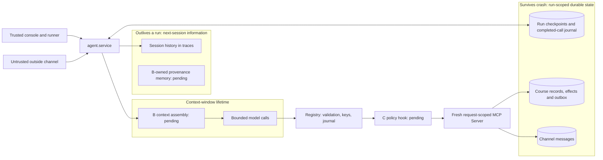

# Milestone 2: Course Q&A Assistant

This is the Part A implementation record, owned by Jingyu Huang (CNetID:
jyhuang28), November 21, 2026, America/Chicago. It is not a complete M2 submission.
Part B, Part C, the topology branch and the two formal passes remain integration
work. M1 verdicts, including `plan.batch=off`, are retained.
See the [Part A verification report](../requirements/M2_PART_A_TEST_REPORT.md)
and [B/C handoff contracts](../requirements/M2_PART_A_HANDOFF.md).

## Build table

| Piece | Implementation | Runnable evidence | Status / owner |
|---|---|---|---|
| Durable run state and resume | sandbox/execution.py; agent/execution.py; service.py | RuntimeTests kill/restart matrix and planned/program recovery | Built / Jingyu Huang |
| Unknown-write exits | Registry._confirm; course.effect_by_key; exchange.confirm | Confirmed, absent and inconclusive-write tests | Built / Jingyu Huang |
| MCP server | agent/mcp_transport.py; SDK 1.30.0 | MCP order/error tests; every valid dispatch invokes SDK Server | Built / Jingyu Huang |
| Deferred loading | Registry.definitions/_find_tools | Deferred first/next request and miss tests | Built, default all / Jingyu Huang |
| Code calls | agent/code_calls.py; code_worker.py | Program end-to-end, keyed writes, rejection and confinement tests | Built, default off / Jingyu Huang |
| Outside exchange and wait | service._clarify/on_outside_reply; sandbox/exchange.py | topic_clarification task; new-process wait and send-gap tests | Built / Jingyu Huang |
| Reverse compensation | course.compensate_effect; service.compensate_run | Reverse-order, once-only compensation test | Built / Jingyu Huang |
| B/C integration points | agent/execution.py | Context-adapter and stale-stop tests; M2_PART_A_HANDOFF.md | Interfaces built / Jingyu Huang |
| Context budget, notes, compaction and memory | B adapter/module integration | Must add long-session and later-session evidence | Pending / owner to confirm |
| Policy, approvals, queue, escalation, stop and mid-task messages | C adapter/module integration | Must add C's environment checks and human review evidence | Pending / owner to confirm |
| Topology branch and decision record | Part B's topology work | Must build/test split even if single is selected | Pending / owner to confirm |
| M2 baseline and two passes | Team integration | Must run after integration; no free test counted as an arm | Pending |

## Decision table

Entries below cover A. B/C must extend the same columns/rows with their lecture
decisions and evidence, rather than replacing the M1 verdicts.

| Place | Path | Checkpoint | Loading | Code calls | Ask outside | Durability | Reason, evidence and reopening condition |
|---|---|---|---|---|---|---|---|
| Investigation model-selected write | agent | Yes: persist response/call arguments before dispatch | all | | | sync | L4 slides 10–14: replay must not ask a model for different arguments; kill matrix. Reconsider storage granularity only if replay safety is preserved. |
| Validated plan write | planned agent, switch off by M1 verdict | No additional full pre-write snapshot: validated arguments/outputs and call key already retained | all | | | sync | L4 slide 13: key closes replay of fixed intent; planned recovery test. Changes if a target cannot deduplicate. |
| Fixed workflow draft/flag | workflow | Call journal, no model conversation checkpoint needed | | off | No for complete-topic cases | sync | L4 slides 13–14: reconstruct fixed control from cached reads; main-task recovery matrix. Changes if step order becomes dynamic. |
| Cheap public read | either | No additional pre-read snapshot; cache completed result | all | | | sync within a writing run | Changes nothing; safe to replay if interrupted. Completed calls are reused. |
| Missing public topic | workflow before normal route | Yes: persist wait and exact send intent | | | Yes | sync | L5 slide 35/L4 slide 38: code sees required topic missing; topic_clarification. Changes if the input already identifies the topic. |
| Complete-topic deadline | workflow | Existing keyed-write journal | | off | No | sync | Asking supplies no missing fact; deadline task. |
| Current seven-tool model surface | | | all | | | | L3 slides 23–25: below about ten tools; deferred is built and switchable, with miss logging. Reopen if measured cost or selection errors justify it. |
| Batch of at most three questions | bounded agent; plan off | Persist pending program/calls if enabled | all | off | Only a case with a missing topic | sync | L3 slides 26–27: too few results to justify a program. Closest use case has code-call mode built and tested. Reopen from a measured many-result problem. |
| Single complete-topic lookup | workflow | Existing journal | | off; not built here | No | sync | No many-result loop; no program needed. |
| Operator status/summary | workflow | No resumable task required | | | No | exit | Read-only, deterministic. Trace/history already persists; no external effect to repeat. |

## Part 1 — State, tool execution and outside exchange

**Owner of the Part A sections below:** Jingyu Huang (CNetID: jyhuang28).
Context, notes and memory sections remain for B; they are not implemented by
the pass-through context adapter.

### Lifetimes and durability boundary

The diagram's zones describe logical lifetimes: a durable trace can survive a
restart too, while a checkpoint describes one run rather than reusable memory.
All domain access remains in sandbox modules. The console and outside channel
remain separate trust sources. Source: this implementation, read November 21.

Each console run is session plus a transactionally allocated number. A runner
run uses its harness run ID plus that number. The wait, journal and hold use
the same key. SQLite FULL synchronous commits save serializable state; no live
connection, file handle or worker is checkpointed. The plan path saves accepted
plan/version, executed prefix, outputs, pending checkpoint/revision and attempt
counts. The loop saves its current conversation and pending response/call list
before dispatch. Thus model-selected write arguments survive a crash unchanged.
Only the current run's messages are retained, within M1's external step/token
bounds; B owns context trimming and long-session compaction. Console histories
already persist in traces and appear again after `make serve`.

All writing runs use sync mode, including reversible keyed drafts/flags. This
small local workload favors explicit reproducibility over asynchronous save
gaps. A read-only operator summary uses exit mode: losing its in-flight result
is harmless. No async mode is selected. Cheap reads need no extra pre-read full
checkpoint; their completed results are journaled. A fixed keyed write needs
no additional full model snapshot, since its intent is reconstructible from
the validated plan or workflow and cached results. A model-generated call does
need the pending response snapshot before it runs. The registry's prepared-call
journal records exact arguments for all calls as an additional audit record.

### Steps, recovery and writes

| Step / path | Classification | Replay behavior / checkpoint |
|---|---|---|
| Question, search, document and public-answer reads | read | Reuse completed journal result; an interrupted read may safely repeat. |
| Create pending reply / flag, every path | keyed reversible write | Keyed by run, tool and question; target returns first effect. Save model-selected arguments before dispatch. |
| Fixed clarification question | registry-keyed, irreversible channel write | Durable outbox intent plus read-back; no blind resend after an unknown result. |
| Compensation | keyed reversible write | Target atomically stores first compensation result, status and audit; reverse completed-write order. |

The coordinator decides; individual calls perform effects. Resume is triggered
by `resume` at the console, a valid outside reply, or C's future approval/hold
callback. Nothing resumes on startup. Restored plan steps are skipped; loop
messages and pending calls are restored; fixed workflows reuse the journal.
Saved arguments are checked against scope and the current hook before an
unfinished call executes. Completed calls need neither re-execution nor another
approval. Step, token and active wall-time bounds do not reset on resume;
external waiting time does not consume active execution time.

Every uncertain write first reads its environment: **yes**, return the existing
effect/message; **no**, retry with the saved key, capped at three attempts;
**unknown**, persist a hold for course staff with `write_unresolved`. The hold
does not publish a guessed result. Until C's escalation UI is integrated, the
console names the held run and staff resolve it explicitly. Fixed questions use
an outbox before `channel.send`, then inspect matching messages after the saved
channel ID under the same session. Ownership and one active wait per thread
prevent concurrent replay; the two SQLite stores are not falsely called one
atomic transaction.

On permanent execution failures, completed pending drafts/open flags are
compensated newest first through Registry/MCP; audit history remains. A sent
message has no recall and records `none`. Normal drafts remain pending for an
operator. Clarification cannot be last: the answer is a prerequisite for the
task. Its exception is deliberately narrow: a fixed public-topic question,
one thread, no private facts, with automated-agent disclosure. Other irreversible
publication is not exposed by A.

| Write | Confirming read | Recovery evidence |
|---|---|---|
| Reply / flag | `course.effect_by_key` | Every task killed after final commit, before journal acknowledgement; one effect per intended write after resume. |
| Fixed question | Outbox plus `channel.messages` after saved ID | Send-gap test kills after send; resume leaves one question, then uses the reply. |
| Compensation | `course.compensation_by_key`, effect status and audit | Reverse order and repeated compensation leave one status/audit change. |

### MCP and tool-list decisions

The installed/pinned SDK is **mcp 1.30.0**, whose declared latest protocol is
**2025-11-25**, inspected November 21, 2026. It lags the course's stateless
revision. A fresh SDK `Server` handles each JSON-RPC request over in-process
memory streams with `stateless=True`; there is no initialize exchange or state
carried between server instances. Registry/call state remains in our code and
SQLite. No Roots, Sampling or Logging capability is used. See the
[official SDK source](https://github.com/modelcontextprotocol/python-sdk/tree/v1.x)
and [modern-revision migration notes](https://github.com/modelcontextprotocol/python-sdk/blob/main/docs/migration.md),
read November 21. This is a tested v1 compatibility adapter, not a claim that
the SDK implements the newer revision natively.

Every valid model/workflow/program call reaches the SDK server after Registry
validation and the hook. Requests carry run/scope IDs and a registry-only write
key; results carry semantic record/message IDs. Lists use fixed order. Execution
failures use `isError`; unknown methods/tools or malformed arguments use JSON-RPC
errors. The registry starts the in-process server without a separate command.
No strict tools are selected (`strict.flag=off`), so there is no vendor strict
acceptance claim or paid strict probe in this change. Local schemas remain
mandatory. Google's compatibility documentation is a separate source, not a
substitute for a future vendor response if a strict tool is selected:
[OpenAI compatibility](https://ai.google.dev/gemini-api/docs/openai), read November 21.

M1 measured 808 extra input tokens per default seven-tool request. Its baseline
had 45 model calls across 30 runs, or 1.5 calls/run: applying that historical
measurement gives **1,212 definition tokens/run** including zero-call workflows.
This is a historical estimate, not a new M2 API measurement. B must add its
chosen per-call/window budget and each split role's tool bill. The per-task
32,000-token bound is not a context-window denominator.

Fixed order comes first; existing consolidated course tools are retained;
`tools.loading=all` remains selected because seven model-facing domain tools are
below the lecture's approximate ten-tool threshold. Deferred mode begins with
question/status/catalogue search and adds only found definitions on the next
call, logging misses. Code-call mode is built on the closest case, a <=3-question
batch, but remains off: it does not loop over hundreds of results. A model writes
a restricted Python-subset program; an isolated process exposes only tool calls
and a few bounded collection operations. No eval/exec, imports, attributes,
network or file capabilities are given to that program. All calls return through
Registry; only the final program result reaches model context. Programs have
source/node/operation/call/result and five-second limits, with repairable errors.

### Asking, abstraction and the boundary inventory

`topic_clarification` models a student who omitted the public course topic.
Trusted metadata states that a topic is required; code notices the missing
field, offers public-topic IDs, sends one fixed question and ends the turn with
`waiting_for`. The reply is labeled `untrusted_student` and accepted only as an
exact offered topic; it never becomes an operator command. The wait lasts at
most 48 hours against the seeded sandbox clock. An expired or uninterpretable
reply holds for staff. A complete-topic deadline question needs no ask.

Known workflow order uses plain code; the investigative path is a bounded tool
loop; the optional plan is a validated executor. Runs outlive a process, so they
use disk checkpoints/journals. We retain the custom harness and leave context
policy to B. There is no crash supervisor: the system does not detect/restart
dead runs automatically. It is a **recovery aid**, not an automatic durable
execution guarantee. The operator or arriving reply fills that gap.

| Fact | Boundary that could lose it | What carries it / remaining gap |
|---|---|---|
| Current operator request, selected IDs, route | restart | Run record; request remains exact. |
| Accepted plan, prefix, pending checkpoint/revision | restart | Plan snapshot and journal. |
| Prepared model call and write key/result | restart | Pending response plus prepared/completed call record. |
| Stranger's reply and missing-topic wait | restart / trust-source confusion | Channel, durable wait and labeled/validated topic observation. |
| Agent step/token/active-time spend | restart | Persisted bounds. |
| Earlier completed case in this console session | session/restart | Trace history and run records; B integrates context selection. |
| Early fact in a long conversation | attention/compaction | B notes/context work pending; not claimed fixed here. |
| Reusable preference in a later session | session | B memory store/provenance work pending. |

Assignment 4 source: Jingyu Huang's
[assignment repository](https://github.com/ylwhale/agentic-ai-assignment4),
[retained original report](../../experiments/assignment_evidence/assignment4_runtime/LAB_04.md)
and its hashed source manifest, read November 21. The reported derived-key matrix
has **10/10 crash scenarios** with one comment and one PR. Broken UUID keys have
**2/10 duplicate-comment scenarios**, both at the final comment replay; the other
eight have one comment. These are historical report counts, not newly regraded
tracker data or our model's success rate. They motivate saving exact intent,
stable keys and independent read-back. The report's attention/compaction/session
examples also explain why a checkpoint is not a substitute for B's notes/memory.

## Part 2 — Autonomy and human control

Pending C integration: three-column policy, computed approval screens, queue,
escalation, stop commands and mid-task messages. A exposes durable hold/resume,
rollback and hook interfaces; it does not claim these C features are built.

## Part 3 — Topology

Pending B integration. Create `m2-split` from main after Part 2 is integrated;
build and test the split even if gates choose single. Keep one shared budget and
Registry/hook. Merge only after the required favorable matched-budget pass;
otherwise retain the required split branch/tag and decision record on main.

## Part 4 — Baseline and improvement passes

No M2 real-model baseline or measured pass is claimed by this update. The
retained A report contains free mechanism tests and original recovery traces.
After B/C integration run the complete task set, including sessions, three
sweeps. Continue ledger numbering from M1: at least Pass 2 and Pass 3, sequential,
each from an observed problem and an advance-pushed prediction. Each arm uses
the same code and at least five identical tasks, three sweeps, with all other
tasks included to check regressions. Do not substitute a fake test for an arm.

## The team

| Owner | Named scope |
|---|---|
| Jingyu Huang (jyhuang28) | Part A runtime/recovery, MCP, tool loading/code calls, outside exchange, tests, source citations and this implementation record. |
| B owner to confirm | Context, notes, memory, topology and a formal pass. |
| C owner to confirm | Policy, approval/queue, escalation, stop/messages, disclosure completion and a formal pass. |

## AI assistance

Codex wrote the Part A implementation, tests and English documentation; checks cover sandbox effects, real SDK dispatch, process-kill recovery, capability confinement, original source hashes and full regression tests.
