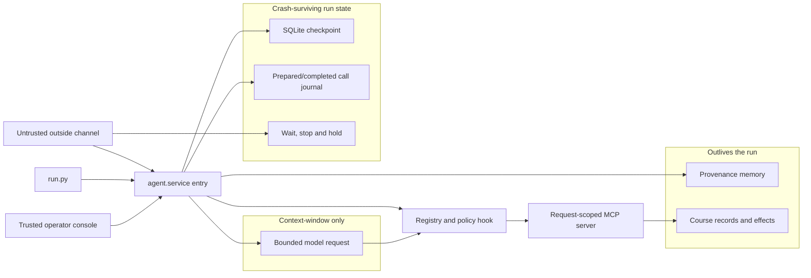
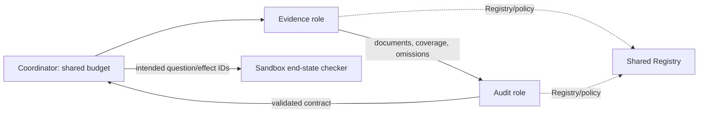

# Milestone 2: Course Q&A Assistant

Status at November 22, 2026: the Part 1 runtime, Part 2 control layer,
bounded context/provenance memory, and required candidate split are integrated.
The formal real-model build and two sequential measured passes are complete;
220 tests, all structural checks, and a clean-checkout app smoke test pass.
Only the project-specific human approval measurement remains to be inserted
before the final `m2` tag. Historical Assignment 2/4/5/6 figures are recorded
separately from project evidence.

Specification: [verbatim requirements](../requirements/M2_REQUIREMENTS.txt). Supporting records: [Part A verification](../requirements/M2_PART_A_TEST_REPORT.md), [assignment evidence](../requirements/M2_ASSIGNMENT_EVIDENCE.md), [policy](../requirements/PART2_POLICY.md), [approvals](../requirements/PART2_APPROVALS.md), [escalation](../requirements/PART2_ESCALATION.md), [stop controls](../requirements/PART2_STOP.md), [messages](../requirements/PART2_MESSAGES.md), [disclosure](../requirements/PART2_DISCLOSURE.md), and [topology decision](../../decisions/0006-topology.md).

## Build table

| Required piece | Implementation and evidence | Status |
|---|---|---|
| Durable state and recovery | SQLite checkpoints/journal, stable run/action keys, prepared/completed calls, confirmed/absent/unknown write recovery, compensation, cross-process crash tests | Implemented; free mechanism evidence only |
| MCP and tools | Request-scoped MCP SDK server, Registry/policy path, fixed catalogue order, explicit IDs/keys, classified errors | Implemented |
| Loading and code calls | `tools.loading=all/deferred`; restricted Python-subset program with Registry checks and no files/network/imports | Both alternatives built; defaults remain `all` and `off` |
| Outside exchange | Fixed disclosed clarification, keyed send, durable wait/deadline, labelled reply and restart continuation | Implemented |
| Context, notes, memory | Per-call 12,000-token estimated context budget, omission trace, protected tool pairs, safe notes, provenance/supersession store and later-session tests | Implemented locally |
| Policy and approvals | Three-column policy, persisted limits, computed per-action and fixed-plan approval, exact saved-call execution and source/policy recheck | Implemented and tested; human timing row pending |
| Escalation and operator control | Durable unknown-write holds, shared cap/deadline, `/stop`, `/cancel`, `/resume`, `/rollback`, live add/replace/queue/reject | Implemented |
| Disclosure | Code-added AI identity and TA contact, final-message approval and independent outgoing check | Implemented |
| Candidate split | `m2-split`: coordinator plus evidence/audit roles, JSON return contract, shared budget, parent/per-role traces and combined end-state check | Built and retained, not selected for main |
| Evaluation | 220 local tests and structural checks pass; main build passed 33/33 and required long-session supplement passed 3/3 | Passes 2 and 3 completed |

## Decision table

| Decision | Setting | Reason/evidence |
|---|---|---|
| M1 batch planning | `plan.batch=off` | Retain Pass 1 verdict until new measured evidence |
| Tool loading | `tools.loading=all` | Alternative is available; no current measured benefit justifies changing the default |
| Code-call batching | `code_calls.batch=off` | Restricted alternative is available; default preserves the smaller failure surface |
| Context | 12,000 estimated input tokens, with output reserve handled by the existing task bound | Keeps definitions, current request and atomic tool pairs before older material; omissions are traced |
| Memory | Explicit preferences/standing rules only, with source/time/confirmation and supersession | Private student content and unconfirmed outside text are excluded |
| External writes | Per-action approval | Recipient, body, arguments and idempotency key are fixed and rechecked immediately before execution |
| Reviewed send plan | `approval.reviewed_send=plan` | Recipient, disclosed body, sources and gated call are fixed upfront; unlisted or revised sends cross the gate again |
| Unknown writes | Durable escalation hold | Never repeat while read-back remains inconclusive |
| Topology | `topology=single` on integration/main candidate | Equal fake diagnostic success (27/30), split increased median turn time from .033s to .059s, and A6's matched-spend single agent equalled split correctness |

## Part 1 — State, tools, context and memory

**Owner:** Jingyu Huang (runtime, MCP, recovery and outside exchange), with Hao
Shi integrating context, notes and provenance memory.

The durable runtime separates three lifetimes: the current model window; crash-surviving run state; and later-session facts/effects. Every tool attempt is validated through Registry and policy, saved before dispatch, then journalled. A recovered write has three exits: reuse the recorded/read-back result when confirmed, retry the same key only when absence is established, or hold for a human when the outcome is unknown. Final checkpoints are exported into traces. The restricted code-call process cannot import modules, access attributes, files or the network; each `tool(...)` still traverses Registry, policy and MCP.

| Path and durability mode | Ordered steps and checkpoint/wait |
|---|---|
| Read-only lookup — exit | Save route/bounds → repeatable reads → validate grounded result → export final checkpoint; a crash may repeat reads but no effect |
| Effectful reply/flag — sync | Save route/plan → journal exact arguments and stable key before dispatch → call Registry/MCP → journal result → checkpoint cursor; irreversible send, if any, is last |
| Outside clarification — sync then wait | Save fixed disclosed question/key → send → checkpoint `waiting_outside` with thread/deadline → a labelled outside reply invokes continuation; expiry becomes a hold |
| Approval — sync then wait | Save exact call or fixed plan → checkpoint `waiting_approval` → trusted app decision claims it → recheck sources/policy → execute saved arguments or deny |
| Crash/stop continuation — sync | Load checkpoint and completed-call journal → reuse confirmed calls → retry only established absence with the same key → hold unknown writes → continue at saved cursor |

The checkpoint intentionally stores structured execution state, not the full
conversation or live connections. Unknown outcomes escalate to the trusted TA
operator through the Queue/console. Internal drafts and flags have compensations;
student sends do not, so reads and reversible writes precede the final send.
The MCP dependency is SDK `mcp==1.30.0`; request-scoped calls use its protocol
objects, while application failures return `isError`. Strict provider tool
schemas are not claimed because the configured provider does not establish that
mode; Registry validation remains authoritative.

The console session is not the durability key because it may contain several
runs. App runs use the session plus an allocated run number; `run.py` uses its
run ID. The same run key names its checkpoint, wait, stop and review records.
Sync durability is used for effectful runs: a call's immutable arguments and
key are prepared before dispatch, and its result is journalled before the
coordinator advances. Read-only follow-ups use exit durability because a crash
cannot duplicate an effect. The serialized snapshot holds route, request,
question IDs, coordinator cursor, bounds, validated planner/program state,
registry reads, critique rounds and completed calls. It deliberately does not
serialize open connections or the complete chat transcript.

Reads are safe to repeat. Keyed writes are safe only when their arguments and
key are restored together. An unknown write is never treated as absent: the
Registry performs target read-back, reuses a confirmed effect, retries an
established absence under the same key, or creates a durable escalation when
read-back is inconclusive. Reversible internal drafts and flags may be
compensated in reverse order; a sent student message is irreversible and is
last. Resume is call-triggered rather than an unsafe startup sweep: the next
operator turn resumes a crash-stopped run, an outside reply resumes its wait,
and an approval decision resumes the exact saved action.

All domain calls cross a fresh request-scoped MCP SDK server after Registry
schema, scope, policy and key checks. Tool order is deterministic. Application
errors use MCP `isError`; malformed protocol requests remain JSON-RPC errors.
The server keeps no authority-bearing session state: run IDs, allowed questions,
read IDs and action keys arrive as explicit metadata. `tools.loading=deferred`
and `code_calls.batch=on` are real alternatives, not report-only proposals.
The former exposes a small catalogue first; the latter runs a bounded Python
subset in an isolated process. Passes 2 and 3 rejected both defaults on measured
cost/quality, while their boundary and recovery tests remain.

Context is assembled for every model call under a 12,000-token estimate. System definitions, the active request and atomic tool call/result pairs outrank older observations. Safe notes compact older public working facts, but do not copy outside/student content or enter planner input. Provenance memory records source, time, ingestion/derivation and confirmation, replaces contradicted facts by supersession rather than silent mutation, and is loaded before a later session's first model call.

Assembly counts system text, selected messages and tool definitions, leaving the
existing task bound as output/backstop room. It protects the current operator
request and does not split a tool call from its result. Old results are removed
before any lossy shortening; every omission and estimate is traced. Notes are
outside conversation compaction and contain trusted task status/identifiers,
never student wording. Planner requests do not receive notes or memory, which
prevents an untrusted outside sentence from returning as system knowledge.

The required `tasks/sessions/long_context.yaml` carries six near-limit public
documents, an early explicit preference, a grounded action and a late query
about earlier work. Across three real runs it passed 3/3, used 69,669 total
tokens and $0.016863 in the final-code arm, made six context calls per run and
compacted twice per run. The maximum estimated request was 10,600 tokens. Its independent check reads the
effect, trace and memory database, confirming that compaction occurred, all calls
fit, the preference had trusted-operator provenance, memory was read before the
model, and the late reply named the earlier record.

Memory is intentionally narrow. Explicit preferences and standing operator
rules are expensive enough to restate and authoritative enough to retain;
current course records are read from the sandbox instead. Each active record
has kind, name, value, source type/ID and timestamp. Updating a name marks the
old row superseded rather than producing two active contradictions. Outside
text remains channel evidence and is never promoted. The store is small because
only explicit preferences enter; supersession bounds active rows per name, and
deployment should add age-based expiry if the observed write rate grows beyond
the current low-volume console.

The outside-question path is deliberately narrow: code detects the missing public topic, sends a fixed disclosed question with a stable key, exits into a durable wait, validates the offered reply, and resumes in a new process. A timeout or unknown delivery becomes a hold. Assignment 2's notes improved recall from 32/36 to 33/36 at higher token cost, but inconsistently. Assignment 4's stable-key matrix recovered all ten crash positions without duplicate writes, while UUID keys duplicated both commit-before-ack step-5 cases; conversation-inclusive checkpoints cost 4.67x structured state. These historical results motivate, but do not prove, our mechanisms.

## Part 2 — Policy, approval and human control

**Owner:** Yani Wu, with Hao Shi integrating the final fixed-plan mode and tests.

The policy hook classifies each action by autonomy, approval and prohibition before every attempt. Operator limits persist. Approval screens are computed from the immutable saved call and show the action, recipient/target, arguments, source facts, policy basis and key. Approval executes only that call after policy/source rechecks; a changed or unlisted action is gated again. Outside text cannot approve. Unknown writes share a bounded review queue and remain held until staff can establish the effect.

| Action class or group | Undo and visibility | Radius | Column and reason |
|---|---|---|---|
| Public selected reads/searches/status | No mutation; visible in trace | One selected question or public index | Independent: repeating the read is harmless |
| Pending reply/flag creation | Discard/clear compensation; operator sees it | One internal record | Independent unless an operator limit requires review |
| `operator_limit/approval` | Same internal compensation | One selected internal record | Requires approval because the trusted operator explicitly moved it above the line |
| `course_send_reply/student_reply` | Irreversible; student sees it | One outside recipient | Requires approval of exact disclosed text and recipient |
| Restricted/staff-only/private reads or drafts | Disclosure cannot reliably be undone | Private or consequential records | Prohibited; an approval cannot legalize the scope |
| Missing-disclosure or invalid send | Irreversible if allowed | Outside recipient | Prohibited; only a selected, disclosed, unchanged automated draft can send |

This ranking narrows the system instead of asking people about obvious “no”
cases. The model cannot list flags, read restricted documents, draft from private
content or select an arbitrary send target. Reads and reversible visible work do
not consume review attention. These identifiers are identical in policy,
`policy_decision` traces and the approval log.

The three columns are code-owned. Narrow public reads and visible reversible
internal drafts are independent; a final disclosed student send requires
approval; private disclosure, staff-only decisions and missing disclosure are
prohibited. Approval never overrides prohibition. The hook checks stop first,
classifies the concrete call and circumstances, applies persisted operator
limits, and fails closed if the policy cannot be loaded. The model never sees or
edits the policy file. `/limit drafts|writes|sends approval|deny` is parsed before
model work and stored as authority, whereas ordinary chat text has no such power.

The review screen is information rather than recommendation. It renders the
exact effect, recipient, body/arguments, status after execution, records changed,
external reach, source IDs and deterministic source-check result. Student text
appears last and is labelled outside/untrusted; model confidence is not a fact.
Decisions log actor, elapsed seconds, action class, screen, mode, switches, run
and key. Atomic claim prevents duplicate clicks, and a crash after claim remains
visible as executing/uncertain rather than replaying an irreversible call.

Stop is checked before model and tool work. Cancel terminates future work, resume reconstructs saved state, and rollback compensates only effects owned by the run and still permitted by policy. Mid-task add/replace and bounded FIFO messages are observed before the next model call. Automated sends add AI identity and a TA-contact route in code before the final message is reviewed; missing disclosure is rejected.

Fixed-plan approval is used only for reviewed sends, where every gated argument
is known before execution; generated reply gates remain per-action. The executor
re-reads sources and rechecks policy/disclosure, so approval is not a proxy for
output validity. A revised plan or an omitted later send cannot reuse the
decision. Project-specific human timing remains to be measured. Hao Shi's
Assignment 5 prior had 17 decisions, with 16.0-second `open_pr` and 18.8-second
active-comment medians, and a 15-to-12 prompt fixed-plan estimate. Its 100%
approval rate had no planted bad requests and cannot establish review quality here.

| Escalation signal | Covered case | Deliberately not covered | Packet, hold and budget |
|---|---|---|---|
| Unknown write after the three exits | A write may have committed but deterministic read-back cannot confirm or disprove it | Empty search (“not determined”) and doubt about a reversible visible draft | Exact attempt; why outcome is unknown; what the TA must inspect. Checkpoint and hold for 24 hours; shared cap of 20 approvals/escalations per day; over-cap work remains held without a new packet |

| Stop condition | Evidence and limitation |
|---|---|
| Watched | A run notice and resume notice precede the next write in the trace |
| Fast | Five free live probes: median flag-to-first-refused-call 0.114s, maximum 0.117s |
| Durable | Stop snapshot retains request, completed/in-flight calls and keys; resume reissues withdrawn approvals |
| Safe | Completed effects are recorded and owned reversible effects roll back newest-first. **Partly met:** an already-dispatched provider/tool call may still finish |
| Outside the agent | Trusted commands are parsed before the model; hook denial prevents later calls, including role calls |

Cancel preserves completed work and ends the run; resume lifts the interrupt and
continues saved state; rollback applies available compensations in reverse order
and prints `none` for irreversible effects. Mid-task `/add` continues with prior
work, `/replace` starts a fresh keyed run and lists prior effects, ordinary
progress text enters an eight-slot FIFO, and `/reject` refuses immediately.

Escalation is distinct from approval: its named signal is an unresolved write,
its packet says what was attempted, why execution stopped and what staff must
decide, and its default is a durable hold. It shares a 20-request daily reviewer
cap and has a 24-hour deadline; passing the cap suppresses a packet but never
permits the action. Empty search is “not determined,” not low confidence, and a
reversible visible action does not escalate merely because the model sounds
uncertain.

`/stop` is handled outside the model and normal message queue. The hook refuses
the next call for every role sharing the run ID; the checkpoint records completed
and in-flight calls. `/cancel` ends future work, `/resume` releases the saved
state and reissues withdrawn reviews under new IDs, and `/rollback` compensates
only owned reversible effects. Add/replace messages are explicit; ordinary busy
messages use a bounded FIFO, while reject and urgent controls act immediately.
The system cannot preempt a provider/tool call already executing, so safety
depends on journalling its result and applying the three exits before proceeding.

Every automated student send receives the disclosure line in code before review:
it identifies the AI agent and gives a TA contact route. Direct Registry calls
without it are prohibited, and independent checks inspect the actual outside
channel. The current application answers public course questions and does not
make consequential education decisions; the legal assessment therefore treats
EU/Colorado/California rules as scope triggers and design guidance, not a claim
of universal compliance.

For the EU AI Act questions, this is a course-support system, not a banned or
Annex-III consequential decision system; it does interact directly with people
and generate messages, so every automated message identifies the AI agent and a
TA contact. It neither admits, grades nor disciplines students, so the assessed
Colorado/California consequential-decision human-review states are not entered.
A direct Registry send without the disclosure is logged as
`course_send_reply/missing_disclosure` and leaves the outside thread unchanged.

| Attention point | Reader and frequency evidence | Time and what is shown |
|---|---|---|
| Fixed reviewed-send plan | Trusted TA; project asks/run and real-day count pending final human sample | Exact recipient/body/key, sources, checks and immutable plan; computed, no recommendation |
| Per-action generated send or operator-limited write | Trusted TA; project asks/run and class count pending final human sample | Exact effect and computed scope/source facts; outside text last and untrusted |
| Unknown-write escalation | Trusted TA; only inconclusive writes, shared in the 20/day cap | Attempt, stop reason and requested inspection; no default approval |
| Stop/resume notice | Trusted TA whenever a live/held run is interrupted or resumed | Run ID, saved status and owned effects; immediate command rather than queued review |
| Outside message | Student/stranger, one recipient per send | Final content plus code-added AI identity and human contact route |

The remaining human sample will fill runs/day, asks/run, asks/day, minutes/day,
seconds/ask, approval/denial rate and median seconds by action class. The screen
design counters plan-as-output and quick-glance shortcuts by displaying the
exact effect first, deterministic checks separately and untrusted input last;
tests are not presented as proof that the content is correct. Assignment 5's
17-decision sample and 100% approval rate warn that an all-benign sample cannot
measure bad-action detection. Low-volume classes remain gates; above the cap a
run holds rather than training a rubber stamp. In the course's three descriptive
frameworks, the system is bounded operator delegation: the user remains the
responsible reviewer, scope/tool access are explicitly limited, and delegation
policy plus escalation triggers are documented. These placements are design
descriptions, not certifications.

## Part 3 — Topology

**Owner:** Hao Shi (CNetID: haocs).

The candidate split lives on branch `m2-split`. The coordinator gives tool-separated evidence and audit roles a schema-first contract, one shared step/token budget and parent-linked traces. It rejects malformed role output, checks the combined sandbox end state, and catches a planted divergence where role claims disagree with effects.

| Candidate pair | Mid-task dependency and channel | Gate result |
|---|---|---|
| Evidence search ↔ draft writer | Writer needs selected documents and coverage after search; lead return between rounds | Gates 1–2 pass, Gate 3 fails: current batches are at most three and one bounded event log buys context more cheaply |
| Draft writer ↔ policy audit | Audit needs the exact proposed recipient/body/sources; revisions return to writer | Gate 1 fails because every proposed effect requires a handoff |
| Independent question investigations | No cross-question facts; only coordinator budget/end-state aggregation | Gates 1–3 plausibly pass; Gate 4 lacks favourable equal-budget project evidence |
| Role output ↔ environment checker | Checker needs only intended IDs and sandbox state, not role prose | Checkable independently, retained as a system check rather than another model role |

The split's intended benefit is tool-surface specialization and possible batch
parallelism. It requires independent subtasks large enough for elapsed-time
savings to exceed coordination and rechecking. Each role return is schema
validated and includes status, result, searched/omitted scope, tool-call/token
spend and unknowns; coverage and spend are derived from calls, not model claims.
The coordinator enforces one 32,000-token/48-call task budget. Roles do not wait
on or write shared mutable role state, so there is no wait cycle or shared-file
conflict; domain effects remain keyed through Registry. The combined checker is
still required because individually valid returns may disagree with the sandbox.

Every pair was considered before construction. Evidence search and draft writing
need one mid-task handoff; policy audit cannot classify a proposed effect before
receiving evidence; independent batch questions can investigate without talking;
and the final environment checker needs only intended IDs plus sandbox state.
Thus the policy-audit candidate fails Gate 1, and evidence/writer separation
passes the first two gates but fails Gate 3 on batches of at most three: a single
bounded event log buys the same room more cheaply. Independent investigations
are the only plausible parallel component, but the current implementation and
provider path do not establish useful concurrency.

The branch still builds the rejected alternative as required. Evidence and
audit roles have different tool surfaces, their JSON schema names coverage,
omissions and spend, and the coordinator reserves one shared 32,000-token /
48-call ceiling rather than granting each role a full budget. Parent, agent and
wait relationships are traced. The combined checker rereads sandbox effects;
role claims cannot establish completion. A malformed return test and a planted
divergence test fail safely. After merging final main, the split branch passes
223 tests and all structural checks; tag `m2-split-final` names commit `f70fe05`.

The clean fake diagnostics ran every task three times. Single and split each passed 27/30 and used 6,120 accounted model tokens; all three failures in each arm were the same batch false finish. Split median turn time was .059 seconds versus .033 for single and its slowest turn was .196 versus .102. These are free deterministic diagnostics, not model-quality evidence. Hao Shi's Assignment 6 found matched-spend sequential S-plus equalled split M at 12/18 single-issue passes, while both passed 0/6 batches; its split/single token multipliers were 0.49x and 0.40x. With no project benefit and higher diagnostic latency, integration remains single. The split can be reopened after a favourable equal-budget real-model result. See `decisions/0006-topology.md`.

## Part 4 — Build and improvement passes

The real M2 build ran the ten main tasks and the new outside-clarification task
three times each. All 33 passed; total usage was 107,257 tokens and $0.038866,
with no turn above ten seconds. The nine Agent-path runs consumed all model
tokens; batch used 14,906–15,264 tokens per run while workflow paths used none.
The first optimization problem was therefore definition/input cost, not the fake
model's earlier false finish. Pass 2 compared `tools.loading=all|deferred` on
ambiguous, batch and conceptual tasks. Both passed 9/9, but deferred increased
input tokens from 107,283 to 155,408 (+44.9%), total cost from $0.039895 to
$0.055595, model calls from 57 to 74 and median turn from 1.8695s to 2.257s.
The 22 catalogue calls outweighed the smaller initial surface, so the verdict
keeps `tools.loading=all`. Pass 3 was selected only after this negative result.

Pass 3 compared the ordinary batch loop with restricted code calls. Off passed
3/3 using 45,826 total tokens and $0.015930. On cut usage to 14,828 tokens and
$0.009629 but passed 0/3: one run exhausted its step bound after program errors,
and two programs returned without creating required effects. The environment
check—not model text—found the missing `SYN-Q-deadline` effect each time. The
verdict keeps `code_calls.batch=off`; lower cost cannot compensate for zero
grounded completions.

| Pass | Problem and lecture test | Prediction | Before / after | Verdict |
|---|---|---|---|---|
| [2](../../experiments/LEDGER.md#pass-2--reduce-the-full-tool-definition-bill) | Definition bill: do seven full tools cost more than catalogue turns? | Deferred >=8/9 and >=10% lower input | Both 9/9; all 107,283 input vs deferred 155,408 | Keep `tools.loading=all` |
| [3](../../experiments/LEDGER.md#pass-3--keep-batch-intermediates-out-of-model-context) | Code calls: can a bounded batch keep intermediates out of context? | On >=2/3 and >=20% lower input | Off 3/3, 40,433 input; on 0/3, 12,473 input | Keep `code_calls.batch=off` |

The formal build requirements are satisfied: the credential was supplied only
through the process environment; predictions were committed and pushed before
their arms; all M2 build tasks and the required long session ran three times;
and both sequential comparisons retain provider-reported costs, latency, token
counts and first-failure trace lines. Fake records under `results/_free` are
diagnostic only and are not counted as this evidence.

## The team

Jingyu Huang implemented Part 1's durable runtime, checkpoints/journal, MCP,
loading/code-call alternatives, outside wait and recovery tests. Yani Wu
implemented Part 2's policy, per-action approvals, escalation, stop, live
messages, disclosure and legal assessment. Hao Shi (CNetID `haocs`) owned Part
3 and final integration: context/memory completion, fixed-plan approval,
assignment evidence, split decision/build, real M2 build, Passes 2–3, report
reconciliation, remote delivery and clean-clone verification. Each member must
review the integrated code and confirm this allocation before Canvas submission.

## AI assistance

AI coding assistance was used to inspect, integrate, test and document the repository. Team members remain responsible for reviewing the code, validating measurements, supplying course-assignment evidence, and making the final submission claims.

## Appendix — approval screen evidence

The live page renders these fields from the immutable saved call in
`policy/approvals.py`; `app/templates/approvals.html` adds no recommendation.
The two policy action classes that can enter the gate are shown below. Values
are generated from synthetic course records. A model rationale is neither
requested nor displayed, so there is no asserted recommendation to approve.

### `course_send_reply/student_reply` — plan or per-action screen

| Screen line | Provenance |
|---|---|
| Approval ID, session ID, run ID and creation time | **Computed** from the durable approval record |
| Review mode (`plan` or `per_action`) | **Computed** from `approval.reviewed_send` and the saved request |
| Complete gated plan: exact read/check/send steps and output checks | **Computed** from resolved tool calls; displayed only in plan mode |
| Tool, question/thread recipient, exact disclosed body, source IDs, effect ID and action key | **Computed** from the immutable prepared send |
| `publishes_to_student=true`, records changed and irreversible status | **Computed** from the selected effect and tool semantics |
| Question author, draft creator and input/source record IDs | **Computed** from sandbox records |
| Source visibility/activity, private-marker result and source-check result/detail | **Computed** by deterministic checks immediately before gating |
| Student message text and author | **Outside text, untrusted**; escaped and displayed last |
| Model rationale or recommendation | **Asserted: none displayed** |

### `operator_limit/approval` — per-action screen

| Screen line | Provenance |
|---|---|
| Approval ID, session ID, run ID and creation time | **Computed** from the durable approval record |
| Review mode (`per_action`) and matching operator limit | **Computed** from the saved session rule and request |
| Exact internal draft/flag tool, arguments, scoped question IDs and action key | **Computed** from the immutable saved call |
| `publishes_to_student=false`, records changed and reversible internal status | **Computed** from tool semantics |
| Question author, draft creator, source IDs and external reach | **Computed** from sandbox records |
| Source visibility/activity, private-marker result and source-check result/detail | **Computed** by deterministic checks |
| Student message text and author, if present | **Outside text, untrusted**; escaped and displayed last |
| Model rationale or recommendation | **Asserted: none displayed** |

The human-review run will add its clean synthetic page captures beside these
tables and supply the timing/rate row in Part 2. Captures must contain no
credentials or real student data. Unknown-write holds and post-decision state
belong to the Queue page rather than a third gated action class; they are tested
as lifecycle evidence and may be included as supplemental captures.
