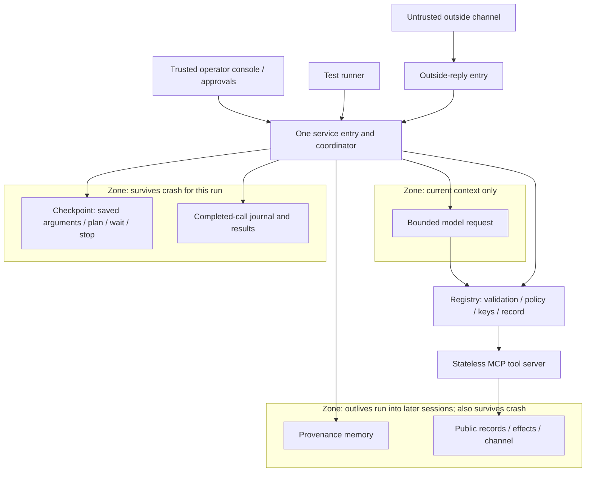
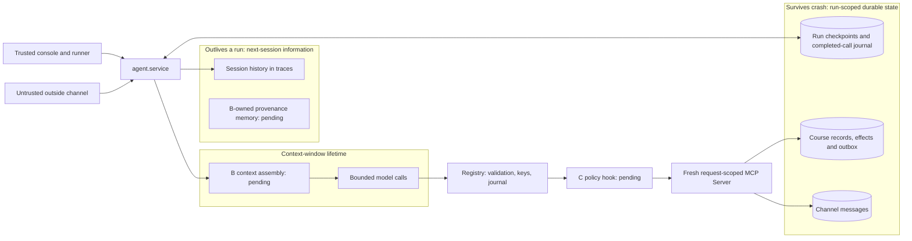

# Milestone 2: Course Q&A Assistant

Working report initialized November 22, 2026 (America/New_York). **Status: Part 2 policy, per-action gate, escalation holds, stop controls and live mid-task messaging and disclosed automated sends implemented; M2 build incomplete.** Specification: [verbatim requirements](../requirements/M2_REQUIREMENTS.txt), [source record](../requirements/M2_SOURCE.md), [implementation audit](../requirements/M2_COMPLIANCE.md). Proposed decisions below are not measured verdicts or implemented features. Yani Wu owns Part 2; other owners remain pending the team's allocation. M1 ownership is not automatically carried into new M2 work. Current Part 2 completion status is tracked in the [task checklist](../requirements/PART2_CHECKLIST.md).

## Build table

| Piece required by M2 | Existing code / intended integration | Current evidence and missing acceptance test |
|---|---|---|
| Checkpoints and resume | agent/service.py; agent/planning.py; sandbox/course.py | In-memory coordination; missing durable journal and cross-process kill/resume test |
| Three exits | agent/tools.py; sandbox/course.py | Normal readback/ambiguous halt; missing durable confirmed/absent/unknown recovery |
| MCP server | Integrate behind agent/tools.py | Not built; every call must reach server with IDs/key, fixed order, classified errors |
| Deferred loading | Registry definitions and MCP catalogue | Not built; first/next request and no-match tests required even with all default |
| Code calls | Registry and restricted program process | Not built; hook/key/errors/network/filesystem/context-isolation tests required |
| Outside exchange and wait | channel/; agent/service.py:on_outside_reply | Callback stub; ask/process exit/reply/new-process continuation test missing |
| Context assembly | agent/bounds.py and all model callers | Cumulative task limits only; budget-fit and omission/provenance tests missing |
| Notes and compaction | Model messages and persistent session record | Not built; notes unchanged, no outside words/planner leakage, long-session test missing |
| Memory and later session | New provenance store; service entry | Not built; two-process read-before-model and third-session contradiction test missing |
| Policy and hook | policy/autonomy.yaml; policy/hook.py; policy/state.py; agent/tools.py | Three-column classification and durable operator limits; 12 policy tests; per-action gate and stop controls are implemented separately below |
| Approval gate and queue | policy/approvals.py; service callbacks; app/templates/approvals.html; sandbox/queue.py | Persisted per-action gate, computed screen and exact-call execution after restart; 15 new tests. Whole-plan approval and general task continuation pending |
| Escalation | policy/escalations.py; registry/service/planner; sandbox/queue.py | Named unknown-write signal, saved packet/hold, shared cap, deadline and later-process confirmation; 14 tests. Full Part 1 checkpoint/absent retry/continuation pending |
| Stop and three commands | policy/controls.py; agent/bounds.py; registry/service/hook | 13 control tests, including five live stops; cancel, approval reissue and reverse compensation work. Full Part 1 task/outside-wait continuation pending |
| Mid-task messages | policy/messages.py; service dispatcher; Bounds.model; queue/console | Explicit add/replace, eight-slot FIFO/reject and selected compensation; 17 tests with independent concurrent checks. Full restarted/outside-wait integration pending |
| Disclosure | policy/disclosure.py; hidden course_send_reply; keyed channel target | 16 tests, exact final-message gate, missing-line denial and independent outgoing checks; legal scope assessed in PART2_LEGAL.md |
| Split on branch | m2-split after Part 2 | Not built; contract/schema, end-state, parent/token trace and shared-budget tests missing |

## Decision table

These are starting design proposals. Add one row per action circumstance, side-effecting step, use case/session/fact kind and candidate component as implementation decisions are made. Every row needs its lecture test, yes/no case, code/evidence, owner and final setting.

| Scope | Test / proposed answer | Setting or decision | Status / evidence needed |
|---|---|---|---|
| Existing M1 controls | Retain measured choices | plan.batch=off and other existing settings | M1 Pass 1; do not reset switches to starter defaults |
| Crash survival | Active model/planner state is currently lost | Durable per-run checkpoint and journal | Required; classify each path and durability mode before coding |
| Tool loading | Current model-facing list has seven tools | Proposed all; build all/deferred | Recount after M2 additions; dated tools.loading and tests required |
| Code calls | Existing small lookups do not loop over hundreds of results | Closest candidate: batch; proposed off | Must build restricted alternative and identify a positive/negative case |
| Outside ask | A missing required public clarification can be detected in code | Add a clarification use case; deadline undecided | Deadline and allowed fields need explicit decision; privacy/extension decisions remain staff-only |
| No outside ask | Deadline already present in active public policy | Do not ask student again | Existing deadline task is starting negative case |
| Context | Long console session exceeds bounded input | Budget assembly on every call; notes before compaction | Budget/threshold/session maxima and tests pending |
| Memory retained | Explicit operator preference or standing rule | Candidate retained semantic fact with provenance | Write/replace/evict policy and memory.<kind> pending |
| Memory excluded | Private student data; facts available in current public records | Deny private retention; read current records | Policy and store tests pending |
| Reads / pending internal drafts | Narrow, visible, generally reversible | Independent unless explicitly restricted by operator | Implemented; see PART2_POLICY.md and policy tests |
| Generated external reply | One selected automated draft; irreversible and student-visible | Per-action approval | Final disclosed message, source/policy rechecks and new-process review tested; PART2_DISCLOSURE.md |
| Fixed plan of external actions | Only if every recipient/body is fixed | Candidate plan approval | Build eligible case and re-gate revisions/unlisted actions; no enabling claim yet |
| Private disclosure / staff-only decisions | Outside agent authority | Prohibited | No approval may override prohibition |
| Escalation | Unsettled write outcome is a code signal | Durable TA hold; 20 shared review requests/day, 24-hour deadline (design defaults) | Hold/confirmation tests pass; complete task continuation requires Part 1 |
| Stop | Operator control must precede model work | Interrupt, cancel, approval reissue and owned compensation | Five-condition inventory and five probes retained; complete task/outside-wait continuation pending |
| Candidate split | Independent question investigations in a batch | Evaluate four gates in order; main remains single | Inventory, A6 numbers, branch/tests and matched-budget result pending |

## Part 1 — State, the outside exchange and memory

**Owner:** unassigned. Full task-by-task gaps: [audit](../requirements/M2_COMPLIANCE.md).

The existing M1 state table distinguishes durable effects/traces from in-memory selection, messages and execution state. Traces alone do not provide replay. No current checkpoint implements crash-safe continuation.

The target placement is shown below as a design sketch, not the present build. Source: repository inspection and user-supplied M2 requirements, November 22, 2026. Implementation must confirm the arrows and add each path's marked steps.

Required completion evidence:

- State lifetimes, all steps marked read/keyed/unkeyed, checkpoint yes/no examples and per-kind sync/async/exit decisions; saved chat bounds and durable app run identity.
- Last-write kill -9 and same-ID new-process resume on every writing task, with before/crash/resume sandbox snapshots and final checkpoint in trace. Confirmed/absent/unknown exits, compensation and irreversible-last ordering.
- MCP SDK/version/revision/read date, strict definitions exactly as sent and vendor response, fixed order and registry-to-server tests. No SDK session may hold required application state.
- Definition bill per call/run/role/window with run counts; fixed order, pruning, loading and code-call decisions in the lecture's order. Build both alternatives even if disabled.
- Ask/no-ask cases, keyed question, durable wait/deadline and untrusted labelled reply; restart test through harness.turns.outside_reply.
- Per-call budget including tools, assembly priority/omission rule, atomic call-result pairs, retrieval/whole-input decisions, notes and compaction, full current request retained. Long-session task under tasks/sessions with named correctness counts.
- Memory write policy (what/how/with/when), provenance on every record, no unconfirmed outside words in planner, supersession/age/eviction and measured write-rate lifetime. New session logs store/wait reads before its first model call.
- Four abstraction questions, checkpoint/journal/supervisor verdict and named human-filled gaps. Fact inventory for attention, compaction, session and restart boundaries.
- Cite a member's A2 notes-vs-compaction numbers and A4 killed-step results/boundary fixes. Those results must be read and attributed before any numbers are entered here.

## Part 2 — Autonomy, approvals and the stop

**Owner:** Yani Wu. The action ranking, three-column policy file, registry enforcement and session operator restrictions are implemented; see [Part 2 policy evidence](../requirements/PART2_POLICY.md). Current manual draft review is M1 behavior; the per-action gate is now implemented; unknown-write escalation holds are implemented; stop/cancel/approval-resume/rollback controls are implemented; whole-plan approval and general task-continuation integration remain pending. See [approval evidence](../requirements/PART2_APPROVALS.md).

The implemented rules allow scoped public reads and reversible internal drafts/flags, prohibit restricted records and staff-only replies, and block writes when the operator requires approval. A requires_approval outcome now saves an immutable pending request without a write; an operator decision executes only that saved call through the registry, or denies it without an effect. Policy runs before every dispatch/retry, checks a persisted stop flag first and fails closed. The flag API alone is not a completed stop. No model API call is needed for these policy tests.

The [escalation increment](../requirements/PART2_ESCALATION.md) now holds unknown draft/flag writes, stores a three-field TA packet and blocks subsequent tools. Initial policy: 20 shared review requests/day and 24-hour deadline (design defaults). /escalations opens the queue's held work; /resolve <id> confirm reuses only an independently confirmed effect. Absent/unreadable outcomes remain held for Part 1 recovery. Fourteen tests cover new-process/new-session handling and no duplicates; the full suite passes 143 tests.

The [stop increment](../requirements/PART2_STOP.md) adds immediate console commands, call snapshots and reverse compensation. Resume reissues withdrawn approvals; general continuation remains held for Part 1. Five free live-stop probes measured median 0.114s and maximum 0.117s from flag to refused registry probe (n=5, zero API calls); the report explains the probe's scope. The safe condition is partial because in-flight work may still commit; full durable task replay is also unimplemented. Thirteen control tests pass; the full suite passes 156 tests.

The [mid-task inbox](../requirements/PART2_MESSAGES.md) now accepts explicit /add and /replace, queues ordinary busy messages (eight outstanding slots), and rejects overflow/invalid commands immediately. Old effects are listed, retained by default and compensated only when selected. Replacement uses a fresh run/key namespace and blocks old writes; queued status answers stay bound to their original run. Seventeen tests include two independent fixed_run/check_run fixtures and a planted old-write rejection. Full suite: 173 passed. Persisted waits/crash continuation still require Part 1.

Remaining completion work is tracked task by task in [PART2_CHECKLIST.md](../requirements/PART2_CHECKLIST.md). The open items are whole-plan approval and its dated switches, complete task/outside-wait recovery integration, remaining approval-screen appendix, verified A5 numbers, real-human review workload/rates/times and framework analysis. Existing policy/approval/hold/stop foundations must not be reclassified as missing merely because these remaining items are unfinished.

## Part 3 — The topology

**Owner:** unassigned. Main currently has one model agent; no M2 split branch or accepted split benefit is claimed.

Write the pairwise mid-task communication inventory and candidate-role sketch first. Run independence, independent checkability, cheaper benefit and multiplier gates in order per component; stop at the first no. Cite a member's A6 matched-budget result and measured multiplier.

After Part 2, build m2-split even if no candidate passes: coordinator and at least two roles separated by tool surface. Design the return JSON schema first: result/status, searched/unsearched coverage, calls/tokens and undetermined facts. Derive coverage/spend from calls. Route every role through the same registry/hook/stop; share M1's 32,000-token task budget, not one allowance per role. Reject invalid returns, detect planted combined-state divergence and test every task end to end. Add parent IDs, waits and tokens per role; prevent wait cycles and use keyed compare-and-set if roles share writes.

Create decisions/0006-topology.md on main with gates/evidence, tests, benefits/costs, rejected alternative, testable reopening condition and published-claim spend check. Merge only after passing gates/tests and a favourable measured same-budget comparison. Otherwise keep main single and tag branch m2-split-final; add the dated topology setting and reference that real tag only after it exists.

## Part 4 — The passes

**Owner:** unassigned. M1 Pass 1 is complete; no M2 measured build or pass is yet recorded.

Run all tasks, including sessions and new M2 tasks, three sweeps in m2-build. Read each failure for the first error and cite run ID plus trace line; include slow/costly/frequent-ask cases. Add at most three harder tasks only if needed, then rerun in a new arm before passes.

| Build arm | First failing run and trace line | Lecture failure / observed problem | Candidate fix |
|---|---|---|---|
| Not run | Pending | No invented M2 failures | Choose after build evidence |

At least two new passes are required. Continue numbering with Pass 2 and Pass 3 in experiments/LEDGER.md, but create actual entries only when there is an observed problem and a concrete prediction. Commit and push each prediction before either measured arm; never amend it after runs begin. Keep scripted answers and all other settings constant. Recompute total/per-run tokens, correctness, latency and the fix-specific measures from committed results. M2 prediction timing cannot be retroactively supplied by M1 runs.

| Pass | Problem / run evidence | Lecture test | Prediction | Before / after with n | Verdict and entry |
|---|---|---|---|---|---|
| M2 passes not run | Pending build | Pending | Not published | No measurements | None |

For topology passes, push prediction on main, run both arms on m2-split with model/tools/shared budget/evaluator/tasks recorded, commit results there and bring only those arm folders to main. Report sweep results, actual budget use, multiplier, latency and first anomaly/MAST class. Document exact executable arm commands after switches/tasks exist, not speculative commands for missing functionality.

## The team

Yani Wu owns Part 2 policy, approvals, escalation, stop, mid-task controls, disclosure and their report/test evidence. Ownership is pending for state/recovery/MCP, context/memory/exchange, topology, each M2 pass and the remaining report sections. Each completed section and ledger entry must identify a real role and name. M1 names alone do not establish M2 ownership.

## Appendix — Approval screens

The internal-draft/flag gate now has a computed HTTP screen; its field-by-field provenance is in [the screen inventory](../requirements/PART2_APPROVALS.md#screen-inventory), with rendering and escaped-input tests in tests/test_approvals.py. The actual synthetic [send review HTML](../requirements/evidence/SEND_APPROVAL.html) and [computed data](../requirements/evidence/SEND_APPROVAL.json) show final text and recipient. Plan-review screens and other class examples remain pending.

## AI assistance

OpenAI Codex saved the supplied M2 specification, inspected the M1 implementation and drafted this working report and audit; source-copy integrity, links and diagnostic check outcomes were reviewed, while M2 feature tests and measured passes remain outstanding.

## Disclosed-send increment

Owner: Yani Wu. [Task 8](../requirements/PART2_DISCLOSURE.md) now has a code-owned AI identity/TA-contact paragraph, operator-selected automated drafts, exact final-message approval and missing-line prohibition. Manual sending refuses automated drafts. Target key/message atomicity and readback prevent duplicate sends in the local channel; absent-effect recovery and complete task continuation remain Part 1 work. Sixteen new free tests pass; full suite: 189 passed. make check passes all four checks with 14 tasks. [Legal applicability](../requirements/PART2_LEGAL.md) answers EU AI Act and current Colorado/California scope using dated primary sources; it is not a blanket deployment compliance claim.
# Imported Part A implementation record

This is the Part A implementation record, owned by Jingyu Huang (CNetID:
jyhuang28), November 21, 2026, America/Chicago. It is not a complete M2 submission.
Part B, Part C, the topology branch and the two formal passes remain integration
work. M1 verdicts, including `plan.batch=off`, are retained.
See the [Part A verification report](../requirements/M2_PART_A_TEST_REPORT.md)
and [B/C handoff contracts](../requirements/M2_PART_A_HANDOFF.md).

## Build table

| Piece | Implementation | Runnable evidence | Status / owner |
|---|---|---|---|
| Durable run state and resume | sandbox/execution.py; agent/execution.py; service.py | RuntimeTests kill/restart matrix and planned/program recovery | Built / Jingyu Huang |
| Unknown-write exits | Registry._confirm; course.effect_by_key; exchange.confirm | Confirmed, absent and inconclusive-write tests | Built / Jingyu Huang |
| MCP server | agent/mcp_transport.py; SDK 1.30.0 | MCP order/error tests; every valid dispatch invokes SDK Server | Built / Jingyu Huang |
| Deferred loading | Registry.definitions/_find_tools | Deferred first/next request and miss tests | Built, default all / Jingyu Huang |
| Code calls | agent/code_calls.py; code_worker.py | Program end-to-end, keyed writes, rejection and confinement tests | Built, default off / Jingyu Huang |
| Outside exchange and wait | service._clarify/on_outside_reply; sandbox/exchange.py | topic_clarification task; new-process wait and send-gap tests | Built / Jingyu Huang |
| Reverse compensation | course.compensate_effect; service.compensate_run | Reverse-order, once-only compensation test | Built / Jingyu Huang |
| B/C integration points | agent/execution.py | Context-adapter and stale-stop tests; M2_PART_A_HANDOFF.md | Interfaces built / Jingyu Huang |
| Context budget, notes, compaction and memory | B adapter/module integration | Must add long-session and later-session evidence | Pending / owner to confirm |
| Policy, approvals, queue, escalation, stop and mid-task messages | C adapter/module integration | Must add C's environment checks and human review evidence | Pending / owner to confirm |
| Topology branch and decision record | Part B's topology work | Must build/test split even if single is selected | Pending / owner to confirm |
| M2 baseline and two passes | Team integration | Must run after integration; no free test counted as an arm | Pending |

## Decision table

Entries below cover A. B/C must extend the same columns/rows with their lecture
decisions and evidence, rather than replacing the M1 verdicts.

| Place | Path | Checkpoint | Loading | Code calls | Ask outside | Durability | Reason, evidence and reopening condition |
|---|---|---|---|---|---|---|---|
| Investigation model-selected write | agent | Yes: persist response/call arguments before dispatch | all | | | sync | L4 slides 10–14: replay must not ask a model for different arguments; kill matrix. Reconsider storage granularity only if replay safety is preserved. |
| Validated plan write | planned agent, switch off by M1 verdict | No additional full pre-write snapshot: validated arguments/outputs and call key already retained | all | | | sync | L4 slide 13: key closes replay of fixed intent; planned recovery test. Changes if a target cannot deduplicate. |
| Fixed workflow draft/flag | workflow | Call journal, no model conversation checkpoint needed | | off | No for complete-topic cases | sync | L4 slides 13–14: reconstruct fixed control from cached reads; main-task recovery matrix. Changes if step order becomes dynamic. |
| Cheap public read | either | No additional pre-read snapshot; cache completed result | all | | | sync within a writing run | Changes nothing; safe to replay if interrupted. Completed calls are reused. |
| Missing public topic | workflow before normal route | Yes: persist wait and exact send intent | | | Yes | sync | L5 slide 35/L4 slide 38: code sees required topic missing; topic_clarification. Changes if the input already identifies the topic. |
| Complete-topic deadline | workflow | Existing keyed-write journal | | off | No | sync | Asking supplies no missing fact; deadline task. |
| Current seven-tool model surface | | | all | | | | L3 slides 23–25: below about ten tools; deferred is built and switchable, with miss logging. Reopen if measured cost or selection errors justify it. |
| Batch of at most three questions | bounded agent; plan off | Persist pending program/calls if enabled | all | off | Only a case with a missing topic | sync | L3 slides 26–27: too few results to justify a program. Closest use case has code-call mode built and tested. Reopen from a measured many-result problem. |
| Single complete-topic lookup | workflow | Existing journal | | off; not built here | No | sync | No many-result loop; no program needed. |
| Operator status/summary | workflow | No resumable task required | | | No | exit | Read-only, deterministic. Trace/history already persists; no external effect to repeat. |

## Part 1 — State, tool execution and outside exchange

**Owner of the Part A sections below:** Jingyu Huang (CNetID: jyhuang28).
Context, notes and memory sections remain for B; they are not implemented by
the pass-through context adapter.

### Lifetimes and durability boundary

The diagram's zones describe logical lifetimes: a durable trace can survive a
restart too, while a checkpoint describes one run rather than reusable memory.
All domain access remains in sandbox modules. The console and outside channel
remain separate trust sources. Source: this implementation, read November 21.

Each console run is session plus a transactionally allocated number. A runner
run uses its harness run ID plus that number. The wait, journal and hold use
the same key. SQLite FULL synchronous commits save serializable state; no live
connection, file handle or worker is checkpointed. The plan path saves accepted
plan/version, executed prefix, outputs, pending checkpoint/revision and attempt
counts. The loop saves its current conversation and pending response/call list
before dispatch. Thus model-selected write arguments survive a crash unchanged.
Only the current run's messages are retained, within M1's external step/token
bounds; B owns context trimming and long-session compaction. Console histories
already persist in traces and appear again after `make serve`.

All writing runs use sync mode, including reversible keyed drafts/flags. This
small local workload favors explicit reproducibility over asynchronous save
gaps. A read-only operator summary uses exit mode: losing its in-flight result
is harmless. No async mode is selected. Cheap reads need no extra pre-read full
checkpoint; their completed results are journaled. A fixed keyed write needs
no additional full model snapshot, since its intent is reconstructible from
the validated plan or workflow and cached results. A model-generated call does
need the pending response snapshot before it runs. The registry's prepared-call
journal records exact arguments for all calls as an additional audit record.

### Steps, recovery and writes

| Step / path | Classification | Replay behavior / checkpoint |
|---|---|---|
| Question, search, document and public-answer reads | read | Reuse completed journal result; an interrupted read may safely repeat. |
| Create pending reply / flag, every path | keyed reversible write | Keyed by run, tool and question; target returns first effect. Save model-selected arguments before dispatch. |
| Fixed clarification question | registry-keyed, irreversible channel write | Durable outbox intent plus read-back; no blind resend after an unknown result. |
| Compensation | keyed reversible write | Target atomically stores first compensation result, status and audit; reverse completed-write order. |

The coordinator decides; individual calls perform effects. Resume is triggered
by `resume` at the console, a valid outside reply, or C's future approval/hold
callback. Nothing resumes on startup. Restored plan steps are skipped; loop
messages and pending calls are restored; fixed workflows reuse the journal.
Saved arguments are checked against scope and the current hook before an
unfinished call executes. Completed calls need neither re-execution nor another
approval. Step, token and active wall-time bounds do not reset on resume;
external waiting time does not consume active execution time.

Every uncertain write first reads its environment: **yes**, return the existing
effect/message; **no**, retry with the saved key, capped at three attempts;
**unknown**, persist a hold for course staff with `write_unresolved`. The hold
does not publish a guessed result. Until C's escalation UI is integrated, the
console names the held run and staff resolve it explicitly. Fixed questions use
an outbox before `channel.send`, then inspect matching messages after the saved
channel ID under the same session. Ownership and one active wait per thread
prevent concurrent replay; the two SQLite stores are not falsely called one
atomic transaction.

On permanent execution failures, completed pending drafts/open flags are
compensated newest first through Registry/MCP; audit history remains. A sent
message has no recall and records `none`. Normal drafts remain pending for an
operator. Clarification cannot be last: the answer is a prerequisite for the
task. Its exception is deliberately narrow: a fixed public-topic question,
one thread, no private facts, with automated-agent disclosure. Other irreversible
publication is not exposed by A.

| Write | Confirming read | Recovery evidence |
|---|---|---|
| Reply / flag | `course.effect_by_key` | Every task killed after final commit, before journal acknowledgement; one effect per intended write after resume. |
| Fixed question | Outbox plus `channel.messages` after saved ID | Send-gap test kills after send; resume leaves one question, then uses the reply. |
| Compensation | `course.compensation_by_key`, effect status and audit | Reverse order and repeated compensation leave one status/audit change. |

### MCP and tool-list decisions

The installed/pinned SDK is **mcp 1.30.0**, whose declared latest protocol is
**2025-11-25**, inspected November 21, 2026. It lags the course's stateless
revision. A fresh SDK `Server` handles each JSON-RPC request over in-process
memory streams with `stateless=True`; there is no initialize exchange or state
carried between server instances. Registry/call state remains in our code and
SQLite. No Roots, Sampling or Logging capability is used. See the
[official SDK source](https://github.com/modelcontextprotocol/python-sdk/tree/v1.x)
and [modern-revision migration notes](https://github.com/modelcontextprotocol/python-sdk/blob/main/docs/migration.md),
read November 21. This is a tested v1 compatibility adapter, not a claim that
the SDK implements the newer revision natively.

Every valid model/workflow/program call reaches the SDK server after Registry
validation and the hook. Requests carry run/scope IDs and a registry-only write
key; results carry semantic record/message IDs. Lists use fixed order. Execution
failures use `isError`; unknown methods/tools or malformed arguments use JSON-RPC
errors. The registry starts the in-process server without a separate command.
No strict tools are selected (`strict.flag=off`), so there is no vendor strict
acceptance claim or paid strict probe in this change. Local schemas remain
mandatory. Google's compatibility documentation is a separate source, not a
substitute for a future vendor response if a strict tool is selected:
[OpenAI compatibility](https://ai.google.dev/gemini-api/docs/openai), read November 21.

M1 measured 808 extra input tokens per default seven-tool request. Its baseline
had 45 model calls across 30 runs, or 1.5 calls/run: applying that historical
measurement gives **1,212 definition tokens/run** including zero-call workflows.
This is a historical estimate, not a new M2 API measurement. B must add its
chosen per-call/window budget and each split role's tool bill. The per-task
32,000-token bound is not a context-window denominator.

Fixed order comes first; existing consolidated course tools are retained;
`tools.loading=all` remains selected because seven model-facing domain tools are
below the lecture's approximate ten-tool threshold. Deferred mode begins with
question/status/catalogue search and adds only found definitions on the next
call, logging misses. Code-call mode is built on the closest case, a <=3-question
batch, but remains off: it does not loop over hundreds of results. A model writes
a restricted Python-subset program; an isolated process exposes only tool calls
and a few bounded collection operations. No eval/exec, imports, attributes,
network or file capabilities are given to that program. All calls return through
Registry; only the final program result reaches model context. Programs have
source/node/operation/call/result and five-second limits, with repairable errors.

### Asking, abstraction and the boundary inventory

`topic_clarification` models a student who omitted the public course topic.
Trusted metadata states that a topic is required; code notices the missing
field, offers public-topic IDs, sends one fixed question and ends the turn with
`waiting_for`. The reply is labeled `untrusted_student` and accepted only as an
exact offered topic; it never becomes an operator command. The wait lasts at
most 48 hours against the seeded sandbox clock. An expired or uninterpretable
reply holds for staff. A complete-topic deadline question needs no ask.

Known workflow order uses plain code; the investigative path is a bounded tool
loop; the optional plan is a validated executor. Runs outlive a process, so they
use disk checkpoints/journals. We retain the custom harness and leave context
policy to B. There is no crash supervisor: the system does not detect/restart
dead runs automatically. It is a **recovery aid**, not an automatic durable
execution guarantee. The operator or arriving reply fills that gap.

| Fact | Boundary that could lose it | What carries it / remaining gap |
|---|---|---|
| Current operator request, selected IDs, route | restart | Run record; request remains exact. |
| Accepted plan, prefix, pending checkpoint/revision | restart | Plan snapshot and journal. |
| Prepared model call and write key/result | restart | Pending response plus prepared/completed call record. |
| Stranger's reply and missing-topic wait | restart / trust-source confusion | Channel, durable wait and labeled/validated topic observation. |
| Agent step/token/active-time spend | restart | Persisted bounds. |
| Earlier completed case in this console session | session/restart | Trace history and run records; B integrates context selection. |
| Early fact in a long conversation | attention/compaction | B notes/context work pending; not claimed fixed here. |
| Reusable preference in a later session | session | B memory store/provenance work pending. |

Assignment 4 source: Jingyu Huang's
[assignment repository](https://github.com/ylwhale/agentic-ai-assignment4),
[retained original report](../../experiments/assignment_evidence/assignment4_runtime/LAB_04.md)
and its hashed source manifest, read November 21. The reported derived-key matrix
has **10/10 crash scenarios** with one comment and one PR. Broken UUID keys have
**2/10 duplicate-comment scenarios**, both at the final comment replay; the other
eight have one comment. These are historical report counts, not newly regraded
tracker data or our model's success rate. They motivate saving exact intent,
stable keys and independent read-back. The report's attention/compaction/session
examples also explain why a checkpoint is not a substitute for B's notes/memory.

## Part 2 — Autonomy and human control

Pending C integration: three-column policy, computed approval screens, queue,
escalation, stop commands and mid-task messages. A exposes durable hold/resume,
rollback and hook interfaces; it does not claim these C features are built.

## Part 3 — Topology

Pending B integration. Create `m2-split` from main after Part 2 is integrated;
build and test the split even if gates choose single. Keep one shared budget and
Registry/hook. Merge only after the required favorable matched-budget pass;
otherwise retain the required split branch/tag and decision record on main.

## Part 4 — Baseline and improvement passes

No M2 real-model baseline or measured pass is claimed by this update. The
retained A report contains free mechanism tests and original recovery traces.
After B/C integration run the complete task set, including sessions, three
sweeps. Continue ledger numbering from M1: at least Pass 2 and Pass 3, sequential,
each from an observed problem and an advance-pushed prediction. Each arm uses
the same code and at least five identical tasks, three sweeps, with all other
tasks included to check regressions. Do not substitute a fake test for an arm.

## The team

| Owner | Named scope |
|---|---|
| Jingyu Huang (jyhuang28) | Part A runtime/recovery, MCP, tool loading/code calls, outside exchange, tests, source citations and this implementation record. |
| B owner to confirm | Context, notes, memory, topology and a formal pass. |
| C owner to confirm | Policy, approval/queue, escalation, stop/messages, disclosure completion and a formal pass. |

## AI assistance

Codex wrote the Part A implementation, tests and English documentation; checks cover sandbox effects, real SDK dispatch, process-kill recovery, capability confinement, original source hashes and full regression tests.
